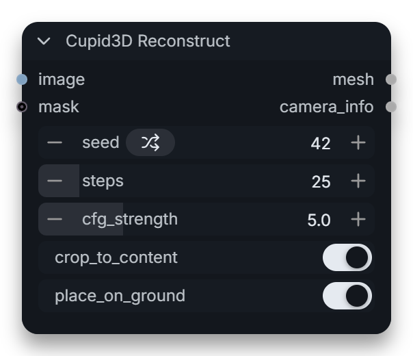

# ComfyUI-Cupid3D

One image in, a 3D mesh and the camera that shot it out. A ComfyUI wrapper around
[CUPID](https://github.com/cupid3d/Cupid) (CVPR'26).

Experimental, and a work in progress.


## The node



**Cupid3D Reconstruct** rebuilds the subject of one photo in 3D and works out the camera
that took it. It takes an `image` and an optional `mask`, and returns a `mesh` and a
`camera_info`.

**The camera describes your input image, exactly as you fed it in.** The same image goes
straight in as the background of `Preview3D`, `Load3D` or NKD Preview 3D, with no padding,
letterboxing or reframing, and the render lines up with the plate. Render at the plate's own
size and the two cannot disagree. It drives the NKD VFX Tools camera nodes too.

Controls:

- `seed` (default 42) and `steps` (default 25) drive both sampling stages.
- `cfg_strength` (default 5.0).
- `crop_to_content` (on) crops to the subject before solving, the way upstream does, and
  corrects the camera back to the full frame afterwards.
- `place_on_ground` (on) rests the mesh on `y = 0`, the floor in any viewer, rather than
  straddling the origin. The camera moves with it, so the alignment with the photo holds.
  Off leaves the mesh in Cupid's own centred frame.
- `mask` is the subject, white on black, which is what segmentation nodes hand you.
  `LoadImage`'s own MASK is `1 - alpha`, so that one needs an `InvertMask` in between.
  With no mask at all the background is removed with rembg.

Geometry comes back with vertex colours and normals, not a baked texture. For UVs and a
texture, run the mesh through core's `UnwrapMesh` and `BakeTextureFromViews`.

<br clear="left">

## Install

Clone into `custom_nodes/` and install, into the Python ComfyUI runs on:

```
pip install spconv-cu126 easydict
pip install "utils3d @ git+https://github.com/EasternJournalist/utils3d.git@9a4eb15e4021b67b12c460c7057d642626897ec8"
```

Also needed:

- **An NVIDIA GPU and the CUDA 12.x toolkit installed.** spconv's prebuilt
  kernels load against it; the node puts `%CUDA_PATH%\bin` on the DLL search
  path for you on Windows.
- **~7 GB of weights** from `hbb1/Cupid`, downloaded on first run, plus DINOv2
  through `torch.hub`.
- About **11.5 GB of VRAM** at peak, measured on a 719×719 input.

No flash-attn, xformers, kaolin, nvdiffrast, pytorch3d or diffoctreerast: the
vendored copy of CUPID under `vendor/` is patched to run on a plain torch
install, and `vendor/PATCHES.md` lists what was changed and why.

If you run a hot-reloader such as LG_HotReload, exclude this pack from it. Reloading a pack
that carries its own inference library swaps the library's classes out from under the models
already in memory, and a run then fails with a type error deep inside the sampler.

Verified on Windows 11, torch 2.10+cu130, an RTX 5090. Upstream is tested on
Linux only.

## Example workflows

All three open from **Templates** in the sidebar, searching "Cupid".

Each one loads an image from ComfyUI's own `input/` folder, so copy
`assets/cupid_test_dragon.png` (from upstream's examples) there to run the first
one as it ships, and point Load Image at your own photo for the other two.

**Image to Mesh and Camera** uses core nodes only. It reconstructs, then renders the mesh
back through its own predicted camera so you can see the two agree.

**Scene integration with Klein 3 removal** reconstructs the subject and drops it back onto
the photo with the subject painted out, so it can be moved around the scene.

**Scene integration advanced (removal + blend)** does the same, plus a second Klein 3 pass
that blends the render into the photograph, and a mask picker to choose the subject with one
click.

The first workflow needs nothing beyond this pack. The two scene ones are examples of what
the camera output is for, and they need:

| Pack | What they use it for |
|---|---|
| [ComfyUI-NKD-Basic-Tools](https://github.com/Nekodificador/ComfyUI-NKD-Basic-Tools) | NKD Loader, and NKD Mask Picker in the advanced one |
| [ComfyUI-NKD-Klein-Tools](https://github.com/Nekodificador/ComfyUI-NKD-Klein-Tools) | Klein Presampling and Postsampling, Box Detections, Reference Control |
| [ComfyUI-NKD-VFX-Tools](https://github.com/Nekodificador/ComfyUI-NKD-VFX-Tools) | NKD Preview 3D, which puts the mesh over the plate |
| [ComfyUI-NKD-Notes](https://github.com/Nekodificador/ComfyUI-NKD-Notes) | the hints pinned to the nodes |
| [ComfyUI-NKD-Preview-Tools](https://github.com/Nekodificador/ComfyUI-NKD-Preview-Tools) | Popup Preview, advanced one only |
| [RES4LYF](https://github.com/ClownsharkBatwing/RES4LYF) | ClownsharK KSampler Beta |
| [Basic data handling](https://github.com/StableLlama/ComfyUI-basic_data_handling) | IfElse |

Each one's Note lists the models it needs.

## Not implemented

- **No baked texture**, as above.
- **No multi-object scenes.** Upstream's per-object path needs MoGe and
  pytorch3d.
- **No Gaussian or radiance-field output**; both need `diffoctreerast`.
- **One image per run.** Extra batch items are ignored, since the node emits a
  single camera.

## Credits

[CUPID](https://github.com/cupid3d/Cupid) by its authors: the model, the weights and the
bulk of the code under `vendor/`, used under the MIT licence, whose notice is kept in
`vendor/Cupid/LICENSE`. CUPID is itself built on
[TRELLIS](https://github.com/microsoft/TRELLIS). FlexiCubes, under
`vendor/Cupid/cupid/representations/mesh/flexicubes`, keeps NVIDIA's licence in that folder.

## License

GPL-3.0. See [LICENSE](LICENSE).
